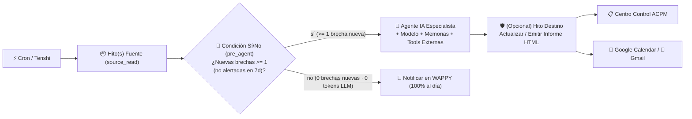
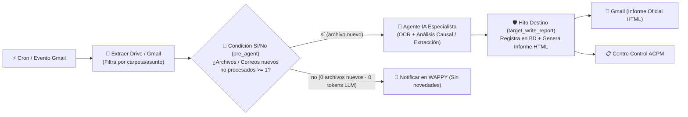
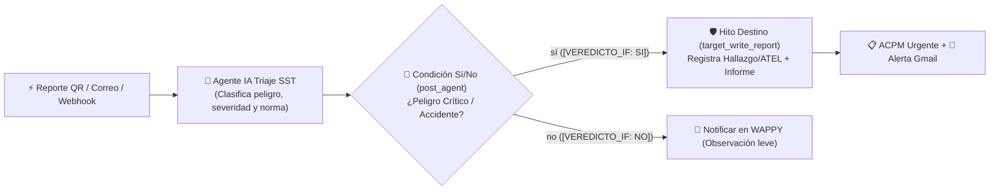
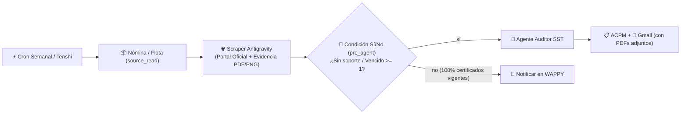
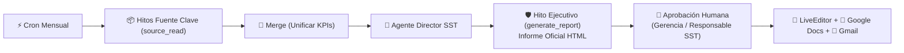

# Especificación Oficial de Arquitectura de Flujos Lógicos — WAPPY IA (`/tareas`)

> **Versión:** `2026.11-v2.0`  
> **Inspiración Arquitectónica:** [Documentación Oficial de n8n (`docs.n8n.io`)](https://docs.n8n.io/) adaptada al ecosistema multi-agente y normativo SG-SST de **WAPPY IA (`Somos SST`)**.  
> ** Subagente Guardián:** [`wappy-workflow-architect`](../.agents/agents/wappy-workflow-architect.md)  
> **Validador Determinista:** [`.agents/skills/wappy-workflow-architecture/scripts/validate-workflow-logic.js`](../.agents/skills/wappy-workflow-architecture/scripts/validate-workflow-logic.js)

---

## 1. Filosofía Central: Por Qué un Flujo NO Es una «Bolsa de Nodos»

Un flujo de automatización profesional —tanto en **n8n** como en **WAPPY IA (`/tareas`)**— es un **Grafo Acíclico Dirigido (DAG) causal de izquierda a derecha** donde cada nodo transforma, filtra, enruta o escribe un arreglo estructurado de elementos (`items[]`).

Un flujo **NO está bien hecho** simplemente porque un modelo de lenguaje devuelva un texto bonito al final. Un flujo solo es **lógicamente válido** cuando cumple simultáneamente:

1. **Causalidad Estricta de Izquierda a Derecha (`Orden Visual === Orden Real de Ejecución`):** Ningún nodo lee datos de un nodo situado a su derecha, y ningún nodo situado en una rama condicional inactiva se ejecuta.
2. **Fuente Única de Verdad (`Cero Redundancia de Datos`):** Jamás se conectan 2, 3 o 4 nodos distintos que consultan la misma colección de MongoDB para «hacer bulto».
3. **Separación entre Lógica Determinista y Razonamiento Agéntico:** Si una base de datos estructurada permite saber en `15 ms` que hoy existen `0` exámenes médicos vencidos o `0` archivos nuevos en Google Drive, **una compuerta determinista (`pre_agent` `IF`) debe cortar hacia la `Rama NO` ANTES de llamar al Agente IA**, ahorrando el 100 % de los tokens LLM y evitando falsas alarmas.
4. ** Estado e Idempotencia Real (`Remove Duplicates`):** Una memoria anti-duplicados real guarda llaves únicas de negocio (`cedula`, `driveFileId`, `gmailMessageId`, `placa`, `caseId`) en base de datos y filtra registros ya alertados dentro de su ventana temporal antes de volver a crear tareas en Kanban o enviar correos repetidos.

---

## 2. Mapeo Arquitectónico Oficial: `n8n` ➔ `WAPPY IA (/tareas)`

| Concepto en `docs.n8n.io` | Equivalente en WAPPY IA (`/tareas`) | Regla de Ingeniería Obligatoria |
| :--- | :--- | :--- |
| **Trigger Nodes** (`Schedule`, `Webhook`, `Email Trigger`) | **Etapa 1 — Disparadores (`triggers[]`)**: `schedule_cron`, `trigger_tenshi`, `trigger_qr_worker`, `trigger_email_in`, `trigger_webhook_in` | Múltiples disparadores operan con semántica **OR** (cualquiera inicia el flujo). Un flujo sin `schedule_cron` jamás es disparado por el reloj horario. |
| **Data Structure (`items[]`)** (`[{ json: {...} }]`) | **`currentPipelineItems[]` / `records[]`** con llave de negocio (`id`, `cedula`, `fileId`, `placa`) | Cada nodo productor entrega `items[]` reales verificables en el modal de 3 paneles (`ENTRADA · CONFIGURACIÓN · SALIDA`). |
| **Read / Get Many Nodes** (`Postgres Select`, `Google Drive List`) | **Etapa 2 — Fuentes de Lectura (`extractors[]` + Hitos `source_read`)** | Todo aplicativo Hito usado **solo para leer/auditar** (`hitoRole: 'source_read'`) va **a la IZQUIERDA** del `IF` y del `Agente IA`. |
| **Remove Duplicates Node** (`Remove Items Processed in Previous Executions`) | **Ledger Anti-Duplicados (`wappy_memory_antiduplicate` + `AutomationLog.processedEntityKeys`)** | Deduplica por llave de negocio (`emo:<cedula>`, `drive:<fileId>`, `gmail:<messageId>`, `pesv:<placa>`) según `dedupWindow` (`24h`, `7d`, `30d`, `all`) **antes** del `IF` y del LLM. |
| **Flow Logic: `Merge` & `Loop Over Items`** (`SplitInBatches`) | **Etapa 2B — Lógica Pre-Procesamiento (`logic_merge`, `logic_loop`)** | Se ubican **después de las Fuentes de Lectura y antes de `Pre-IF` / `Agente IA`**, consolidando múltiples fuentes por llave común o partiendo en lotes. |
| **Flow Logic: `IF` Node** (`True` / `False` branches) | **Compuerta `Condición Sí/No` (`if_node_router`)** con `ifPlacement: 'pre_agent' \| 'post_agent'` | **`pre_agent`**: evalúa conteos/brechas deterministas antes del LLM (`0 tokens` en `NO`). **`post_agent`**: evalúa el veredicto semántico estructurado del Agente sobre entradas no estructuradas. |
| **AI Agent Cluster Node** (`Root Agent` + `Chat Model` + `Memory` + `Tools`) | **`agent_root`** + rombos inferiores (`Modelo IA *`, `Memoria ◆`, `Herramienta +`) | Los sub-nodos inferiores **NO son pasos secuenciales**, sino capacidades acopladas al Agente. En `Herramienta +` solo van herramientas externas/consultivas **no redundantes** con la Etapa 2. |
| **Write / Document Generation Nodes** (`Postgres Insert/Update`, `HTML/PDF`) | **Hitos de Destino (`hitoRole: 'target_write_report'`)** | Van **a la DERECHA del Agente IA** (en la `Rama SÍ` cuando hay `IF`). Registran/actualizan datos en MongoDB y/o generan el Informe Oficial HTML (`req._generatedAppReports`). |
| **Wait for Approval (`Human in the Loop`)** | **Compuerta `logic_human_approval`** | Pausa las salidas críticas de la `Rama SÍ` en estado `awaiting_approval` hasta el Visto Bueno de Gerencia / Responsable SG-SST. |
| **Action / Output Nodes** (`Gmail`, `Google Calendar`, `Jira/Kanban`, `Docs`) | **Etapa Final — Salidas (`outputs[]`)** separadas por `ifBranch: 'yes' \| 'no'` | `Rama SÍ` ejecuta acciones correctivas/escalamiento; `Rama NO` deja trazabilidad silenciosa (ej. `wappy_notification`) sin saturar correo ni crear tarjetas repetidas. |

---

## 3. Las 7 Leyes Inquebrantables de Coherencia Lógica

### Ley 1 — Fuente Única por Entidad (Prohibición Total de Nodos Solapados)
Cada colección de datos tiene **un único nodo canónico recomendado** según el propósito del flujo. Está **TERMINANTEMENTE PROHIBIDO** combinar en un mismo flujo nodos de una misma fila de equivalencia:

| Dominio / Colección MongoDB | Fuente Canónica Preferida (Modo Lectura) | Nodos Mutuamente Excluyentes (PROHIBIDO combinarlos con la fuente canónica) |
| :--- | :--- | :--- |
| **Trabajadores, Demografía y EMO** (`SgsstWorker` + `PerfilSociodemograficoData`) | `hito2_perfil_socio` (`source_read`) o `extract_sst_workers` | `somos_sst_trabajadores`, `somos_sst_examenes`, `extract_sst_workers` (si ya está `hito2_perfil_socio`) |
| **Condiciones de Salud y Ausentismo** | `hito2_condiciones_salud` / `hito7_ausentismo` | `somos_sst_examenes` duplicado con `hito2_condiciones_salud` |
| **Dotación, Inventario y Entregas de EPP** (`SgsstEppData`, `SgsstEppInventory`, `SgsstEppSolicitud`) | `hito3_epp` (`source_read` o `target_write_report`) | `somos_sst_epp` junto con `hito3_epp` |
| **Perfiles de Cargo (`PerfilCargoData`)** | `hito1_perfiles_cargo` | `somos_sst_perfiles_cargo` junto con `hito1_perfiles_cargo` |
| **Perfil de Empresa (`CompanyInfo`)** | `wappy_memory_company` (en `Memoria ◆`) | `somos_sst_empresa` en `Herramienta +` cuando ya existe `wappy_memory_company` (salvo que el flujo actualice el perfil de empresa) |
| **Aplicativos Hitos 1–8 (`MatrizIPEVAR`, `MatrizPESV`, `Diagnostico0312`, etc.)** | El nodo específico `hitoX_<modulo>` | `extract_sst_app` genérico apuntando al mismo módulo que `hitoX_<modulo>` |
| **Google Drive (Lectura de Carpeta)** | `extract_drive` (en Etapa 2) | `google_drive` en `Herramienta +` solo si no se requiere escritura/lectura OCR bajo demanda; cuando el Agente debe leer el binario PDF por `fileId`, `extract_drive` lista los archivos nuevos y el Agente usa `google_drive` internamente |
| **Gmail (Lectura de Bandeja)** | `trigger_email_in` (evento) o `extract_gmail` (consulta por horario) | Usar ambos `trigger_email_in` + `extract_gmail` sin `schedule_cron`, o duplicar `google_gmail` innecesariamente |

---

### Ley 2 — Separación Causal de los Aplicativos Hito (`source_read` vs `target_write_report`)
Un nodo de aplicativo Somos SST (`hito1_*` a `hito8_*`) **NUNCA** es un adorno intermedio ambiguo. Debe declarar explícitamente su rol causal en `canvasLayout.nodeConfigs["tool_hitos_<id>"]` (o `hito_<id>`):

1. **`hitoRole: "source_read"` (`hitoOperationMode: "read_only"`):**
   - **Qué hace:** Extrae registros, casillas quirúrgicas (`selectedFields`) y KPIs reales de la base de datos de ese aplicativo.
   - **Dónde se pinta y ejecuta:** **Etapa 2 (A la IZQUIERDA de `Condición Sí/No` y a la IZQUIERDA del `Agente IA`)**.
   - **Ejemplo:** En *Alerta de Vencimientos EMO, Alturas y EPP*, `hito2_perfil_socio`, `hito3_epp` y `hito3_alturas` son **fuentes de lectura (`source_read`)** que alimentan la compuerta determinista `¿Nuevos vencimientos <= 30d?`.

2. **`hitoRole: "target_write_report"` (`appActionMode: "write_and_report" | "write_and_update" | "generate_report"`):**
   - **Qué hace:** Recibe el análisis estructurado del `Agente IA`, **registra o actualiza el expediente en MongoDB** y/o **genera el Informe Oficial HTML del aplicativo** para entregarlo a las salidas documentales (`email_report`, `canvas_doc`, `google_docs`).
   - **Dónde se pinta y ejecuta:** **A la DERECHA del `Agente IA`** (y si existe `Condición Sí/No`, **exclusivamente dentro de la `Rama SÍ`** antes de las salidas).
   - **Ejemplo:** En *FURAT en Google Drive ➔ Investigación ATEL ➔ Correo*, `hito7_investigacion_atel` es un **destino de escritura e informe (`target_write_report`)**: primero se extrae el PDF de Drive, se verifica que sea nuevo, el `Agente Investigador ATEL` realiza la extracción OCR y el análisis causal (5 Porqués + Ishikawa Res. 1401), y **después** `hito7_investigacion_atel` guarda la investigación en `Somos SST` y emite el Informe Oficial HTML que viaja a `Gmail` y `ACPM`.

---

### Ley 3 — Compuerta `Condición Sí/No` (`pre_agent` vs `post_agent`)
Nunca pongas una `Condición Sí/No` después del Agente IA preguntando algo que la base de datos ya sabía antes de invocar al Agente.

#### Caso A: `ifPlacement: "pre_agent"` (Compuerta Determinista ANTES del Agente IA — **Por Defecto para Auditorías de BD y Carpetas**)
Se utiliza cuando los nodos de la Etapa 2 entregan registros estructurados o conteos verificables (`criticalRecords`, `freshCriticalRecords`, `driveNewFiles`, `gmailNewMessages`, `scraperFindings`):
- **Evaluación en `0 tokens LLM` (`< 50 ms`):**
  - Si `freshCriticalRecords.length === 0` (o `newExternalItems === 0`): toma la **`Rama NO`** directamente hacia `wappy_notification` (dejando constancia auditada de cumplimiento al 100 % o carpeta sin archivos nuevos), **omitiendo por completo la llamada al LLM (`llmSkippedByPreIf: true`)** y omitiendo `targetHitos` y salidas de escalamiento.
  - Si `freshCriticalRecords.length >= 1`: toma la **`Rama SÍ`**, entrega **únicamente los registros en brecha no duplicados** al `Agente IA Especialista`, ejecuta los `targetHitos` configurados y despacha las salidas de acción (`acpm_task`, `email_report`, `google_calendar`, etc.).

#### Caso B: `ifPlacement: "post_agent"` (Compuerta de Veredicto Semántico DESPUÉS del Agente IA)
Se utiliza **únicamente** cuando la entrada es texto libre, audio transcrito, fotografía en campo, correo externo abierto o síntesis clínica/predictiva donde **solo el razonamiento de IA puede clasificar la severidad**:
- El motor exige al Agente emitir al cierre el marcador determinista `[VEREDICTO_IF: SI]` o `[VEREDICTO_IF: NO]` basado en `ifConditionLabel` e `ifRuleExpression`.
- El evaluador de respaldo es **inmune a falsos positivos por negación** (frases como *«0 exámenes vencidos»*, *«sin brechas críticas»* o *«ningún incumplimiento»* jamás activan por error la `Rama SÍ`).

---

### Ley 4 — Deduplicación Con Estado (`wappy_memory_antiduplicate` / `Remove Duplicates`)
Cuando `wappy_memory_antiduplicate` está activo en un flujo:
1. Cada corrida exitosa en `Rama SÍ` persiste en `AutomationLog.processedEntityKeys` las llaves canónicas procesadas (ej. `hito2_perfil_socio:10203040`, `hito3_epp:10203040`, `drive:1AbCdEfGhIjK`, `gmail:18f9a2b3c4`).
2. En la siguiente ejecución dentro de la ventana `dedupWindow` (`24h`, `7d` por defecto, `30d` o `all`), el motor consulta las llaves ya procesadas y **descarta esos ítems antes de evaluar la compuerta `pre_agent` `IF`**.
3. Si los mismos 3 trabajadores con EMO próximo a vencer ya fueron alertados ayer (ventana `7d`) y hoy no apareció un 4.º trabajador nuevo, **`freshCriticalRecords.length` pasa a `0`**, el flujo toma limpiamente la `Rama NO` (sin repetir correos ni tareas Kanban) e informa cuántos casos siguen en seguimiento activo.
4. Además, `acpm_task` aplica **idempotencia en `KanbanTask`**: si existe una tarjeta abierta (`status !== 'done'`) para la misma automatización y título/entidad, actualiza su evidencia y marca de tiempo en lugar de duplicar tarjetas.

---

### Ley 5 — Disciplina del Clúster del Agente IA (`Root + Sub-Nodes`)
Siguiendo `docs.n8n.io/advanced-ai/examples/understand-agents/`:
- **Puerto `Modelo IA *` (`1` nodo):** Solo modelos verificados en `.env` (`gemini-3.5-flash-lite` para triaje/alertas rápidas, `gemini-3.6-flash` para auditoría estándar, `gemini-3.8-flash` para dictámenes normativos/clínicos complejos o investigaciones ATEL).
- **Puerto `Memoria ◆` (`1–3` nodos con rol distinto):**
  - `wappy_memory_company`: Contexto legal de empresa (NIT, CIIU, Riesgo ARL, Responsable SST).
  - `wappy_memory_antiduplicate`: Ledger determinista de llaves ya procesadas.
  - `wappy_memory_procedural`: Marco legal SST colombiano (Dec. 1072, Res. 0312, GTC-45, Res. 4272, PESV, SGA, Res. 1401).
  - `wappy_rag_documental`: Documentos Vivos y cuadernos NotebookLM de la empresa.
- **Puerto `Herramienta +` (`0–3` nodos consultivos o externos reales):**
  - **SÍ van aquí:** `consultar_pubchem_quimico` (NIH PubChem), `consultar_medlineplus_rehabilitacion` (NIH MedlinePlus), `pronostico_clima_sst` (Open-Meteo), `buscar_centros_emergencia` (OSM), `consultar_analitica_psicosocial`, `consultar_analitica_actos`, `cursos_lms`, `custom_scraper_agy_*` (verificación en portales oficiales vía Antigravity), `rule_*` / `skill_*`.
  - **NO van aquí:** Extractores duplicados de tablas que ya entraron por la izquierda en la Etapa 2.

---

### Ley 6 — Bifurcación Limpia y Disjunta (`Rama SÍ` vs `Rama NO`)
Todo flujo con `includeIfNode: true` debe tener:
- Al menos **1 salida en `ifBranch: "yes"`** y al menos **1 salida en `ifBranch: "no"`**.
- **Intersección vacía (`∅`)** entre las salidas de `yes` y `no`.
- Proporcionalidad operativa: nunca enviar correos masivos de alarma ni crear tareas correctivas ACPM en la `Rama NO`.

---

### Ley 7 — Verificación Lógica Multi-Escenario Obligatoria
Está prohibido aprobar un flujo con una sola prueba superficial. Todo arquetipo debe superar:
1. **Validación Estática y Topológica (`validate-workflow-logic.js`):** 0 errores en las 14 reglas formales.
2. **Escenario A (`Caso Positivo / Brecha Real`):** Con registros en brecha o archivo nuevo ➔ activa `Rama SÍ`, ejecuta `Agente IA` (+ `targetHito` si aplica), ejecuta salidas `YES`, guarda `processedEntityKeys` y **omite salidas `NO`**.
3. **Escenario B (`Re-Ejecución Inmediata / Anti-Duplicados`):** Segunda corrida sobre los mismos registros ya alertados ➔ `wappy_memory_antiduplicate` filtra el 100 % de duplicados ➔ `freshCriticalRecords === 0` ➔ toma `Rama NO`, **0 llamadas al LLM**, **0 tarjetas Kanban duplicadas**.
4. **Escenario C (`Caso Limpio / 100 % al Día`):** Con 0 brechas en BD o 0 archivos nuevos en Drive ➔ toma `Rama NO` en milisegundos (`llmSkippedByPreIf: true`), **0 tokens gastados**, ejecuta únicamente la bitácora silenciosa `NO`.

---

## 4. Los 5 Arquetipos Canónicos de Flujos WAPPY IA

### Arquetipo 1 — Vigilancia Determinista de Vencimientos y Brechas en BD (`pre_agent` `IF`)
**Casos de uso:** Vencimientos EMO/Alturas/EPP, SOAT/RTM en PESV, Químicos sin FDS/SGA, Tareas ACPM vencidas, Estándares 0312 en 0 %, Equipos contra caídas sin inspección.

### Arquetipo 2 — Ingesta Documental Externa (Drive / Gmail) ➔ IA + Escritura en Aplicativo + Informe Oficial
**Casos de uso:** FURAT PDF en Google Drive ➔ Investigación ATEL Res. 1401 ➔ Correo; Incapacidades EPS por Gmail ➔ Ausentismo Hito 7; Certificados ARL/Alturas en Drive ➔ Sociodemográfico / Alturas.

### Arquetipo 3 — Triaje en Tiempo Real de Reportes Abiertos (QR / Voz / Webhook) con Veredicto IA (`post_agent` `IF`)
**Casos de uso:** Reporte QR de Actos y Condiciones Inseguras en terreno, SOS de emergencia, consulta ciudadana/trabajador por webhook o correo abierto cuya gravedad requiere clasificación semántica.

### Arquetipo 4 — Auditoría en Portales Oficiales vía Google Antigravity Scraper (`pre_agent` o `post_agent`)
**Casos de uso:** Verificación de cursos de Alturas en MinTrabajo, SENA Sofía Plus, antecedentes o estado vehicular RUNT/SIMIT PESV con captura real de soportes PDF/PNG.

### Arquetipo 5 — Síntesis Ejecutiva Programada Multi-Hito + Visto Bueno Humano (`Direct` o `Human Approval`)
**Casos de uso:** Informe Mensual de Alta Dirección (Dec. 1072 Art. 2.2.4.6.31), Rendición Anual de Cuentas, Radar Predictivo Ejecutivo Hito 8, Boletín Mensual COPASST/CCL.

---

## 5. Caso de Estudio Comparativo: Antes (❌ Incoherente) vs. Después (✅ Arquitectura n8n-WAPPY)

### Flujo: *Alerta Temprana de Vencimientos: Exámenes Médicos (EMO), Alturas y EPP (`preset_vencimientos_emo_epp`)*

| Dimensión | ❌ Diseño Anterior (Defectuoso) | ✅ Diseño Nuevo (`wappy-workflow-architect`) |
| :--- | :--- | :--- |
| **Fuentes de Trabajadores / EMO / EPP** | **7 nodos redundantes** leyendo lo mismo: `extract_sst_workers` + `somos_sst_trabajadores` + `somos_sst_examenes` (truncado a 40) + `somos_sst_epp` + `hito2_perfil_socio` + `hito3_epp` + `hito3_alturas`. | **Solo las 3 fuentes canónicas exactas en Etapa 2 (`source_read`):** `hito2_perfil_socio` (EMO y restricciones), `hito3_epp` (entregas EPP) y `hito3_alturas` (certificados TSA Res. 4272). **0 duplicados.** |
| **Posición de los Aplicativos Hito** | Pintados **después** del Agente IA (Pasos #11–#13) aunque el Agente ya había respondido en el Paso #10. | Pintados y ejecutados **antes** de la `Condición Sí/No` y **antes** del `Agente IA` (Pasos #3–#5), porque son **fuentes de lectura**. |
| **Posición y Lógica de `Condición Sí/No`** | Paso #14 al final del flujo con regex ingenuo que daba falso positivo cuando el Agente decía *«0 exámenes vencidos»*. | **Paso #6 (`pre_agent` Determinista):** Evalúa `freshCriticalRecords.length >= 1` directo sobre las fechas reales de BD. Si es `0`, va directo a `Notificar en WAPPY` con **`0 tokens LLM`**. |
| **Memoria Anti-Duplicados** | Solo inyectaba `600 caracteres` del texto anterior en el prompt y creaba tarjetas Kanban duplicadas cada mañana. | **Ledger estructurado en `AutomationLog.processedEntityKeys`** (`dedupWindow: '7d'`) + **upsert idempotente en `KanbanTask`**. Si el trabajador ya fue alertado esta semana, no repite el correo ni duplica la tarea. |
